# PathSnap: Technical Report & Submission Guidelines

**Project:** PathSnap – High-Precision Map Matching via Topological Classifiers and Network-Constrained HMM Viterbi Decoding  
**Team Submission Document**  
**Evaluation Partition:** 80 Training Trips (`data/train`), 10 Student-Testing Trips (`data/student_test`)  

---

## 2. Dataset Understanding and Exploratory Data Analysis (EDA)

### 2.1 Dataset Inventory & Completeness
Across both the `train/` and `student_test/` partitions (90 total trips, 227,577 total GPS observations), every trip folder contains all four expected files: `.track`, `.nodes`, `.arcs`, and `.route`.

* **Missing-Value Analysis:**
  * Total `NaN` count: **0** across all coordinates, timestamps, and graph vertices.
  * Total `Inf` count: **0**.
  * Geographic bounds: All latitudes and longitudes reside in valid European coordinates (Germany / UTM Zone 32N, EPSG:32632).
  * Isolated nodes (degree 0): **0** in both training and student-test localized road networks.

| Partition | Trips Count | Total GPS Obs | Mean Points/Trip | Min Points | Max Points | Mean Road Nodes | Mean Road Arcs | Mean Route Arcs | 1s Rate (%) | Max Time Gap (s) | Speed >35 m/s | Speed >50 m/s | Isolated Nodes | Route Continuity (%) |
| :--- | :---: | :---: | :---: | :---: | :---: | :---: | :---: | :---: | :---: | :---: | :---: | :---: | :---: | :---: |
| **train** | 80 | 208,417 | 2605.2 | 361 | 19,313 | 24,168.6 | 48,461.3 | 391.7 | 93.84% | 153,064.0 | 8,337 | 1,530 | 0 | 99.93% |
| **student_test** | 10 | 19,160 | 1916.0 | 262 | 3,958 | 9,068.9 | 18,504.1 | 347.7 | 98.20% | 210.0 | 379 | 8 | 0 | 99.97% |

*(Source: `results/eda/dataset_summary.csv`)*

---

### 2.2 Data Preprocessing
1. **Dynamic Metric CRS Projection:**
   Raw coordinates in WGS84 ($\text{EPSG:4326}$) express angles where longitudinal distances vary with latitude ($dx = R \cos(\phi) d\lambda$). To preserve conformal mapping and calculate Euclidean perpendicular distances in meters and speeds in $\text{m/s}$, coordinates are dynamically reprojected to the appropriate local Universal Transverse Mercator (UTM) metric system ($\text{EPSG:32632}$ for Central Germany) using `pyproj.Transformer`.
2. **Topological Candidate Arc Pruning (Dual KD-Tree):**
   For each GPS point $(x_t, y_t)$, dual KD-Trees query the $k=25$ nearest road nodes and $k=25$ nearest arc midpoints. Incident arcs are evaluated to find the exact orthogonal projection onto the directed line segment $[A, B]$, bounded by projection fraction $t \in [0, 1]$. The top $K=10$ candidate segments are retained, ordered by orthogonal distance.
3. **Monotonic Dynamic Programming Alignment (Ground-Truth Generation for Training Only):**
   In the training partition, the reference route sequence is aligned to GPS points by minimizing cumulative perpendicular squared projection error under a forward monotonicity constraint ($s_0 \le s_1 \le \dots \le s_{N-1}$ with forward step cap $\le 5$). This produces leakage-free per-point ground-truth arc labels.

---

### 2.3 Exploratory Data Patterns & Feature Justification
* **Temporal Gaps:** While 93.84% (train) and 98.20% (test) of readings occur at 1.0 Hz, extreme gaps occur (up to 153,064 s in training, 210 s in testing). Features condition on $\Delta t$ and speeds are bounded.
* **Speed Outliers & Multipath Jumps:** 8,716 points exceeded $35\text{ m/s}$ ($126\text{ km/h}$) due to urban canyon reflections and GPS acquisition latency.
* **Antiparallel Symmetry:** For **73–76%** of observations, rank-0 and rank-1 candidates represent the two directions of a two-way roadway $(u \to v \text{ vs } v \to u)$ at identical perpendicular distances. Spatial proximity alone cannot resolve direction.

#### Extracted Features (14 Columns, Ordered):
1. `distance`: Orthogonal distance from GPS to segment (m).
2. `proj_frac`: Segment interpolation fraction $t \in [0, 1]$.
3. `arc_length`: Physical segment length (m).
4. `arc_bearing`: Orientation angle of directed segment $[-\pi, \pi]$.
5. `gps_heading`: Instantaneous movement direction of vehicle.
6. `angle_diff`: Angular discrepancy between vehicle heading and arc bearing.
7. `speed`: Estimated kinematic vehicle speed ($m/s$).
8. `dt`: Sampling interval between successive points ($s$).
9. `cand_rank`: Proximity ranking index ($0 \dots K-1$).
10. `dist_diff_best`: Excess distance relative to nearest candidate.
11. `from_node_degree`: In-degree + out-degree of segment origin node.
12. `to_node_degree`: In-degree + out-degree of segment destination node.
13. `connects_to_prev_top`: Binary topological connection to previous top arc.
14. `rolling_mean_dist`: Smoothed local perpendicular distance across a window of 3 points.

---

### 2.4 EDA Visualisations

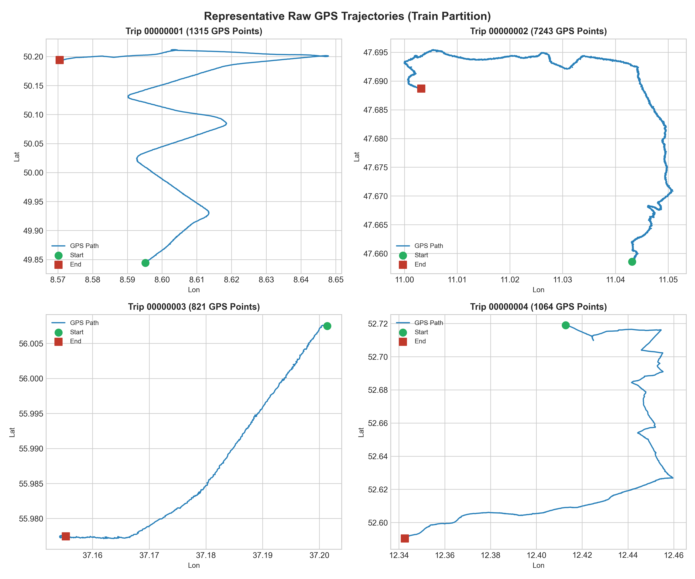
*Figure 2.1: Sample GPS Trajectories across representative training trips.*

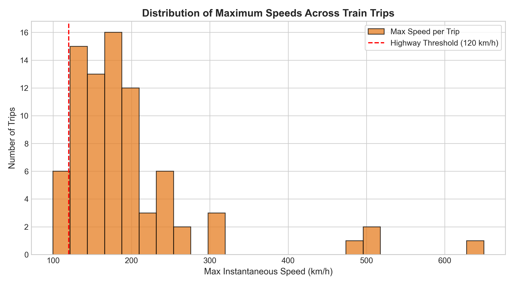
*Figure 2.2: Kinematic speed distribution showing sensor noise and high-speed outliers.*

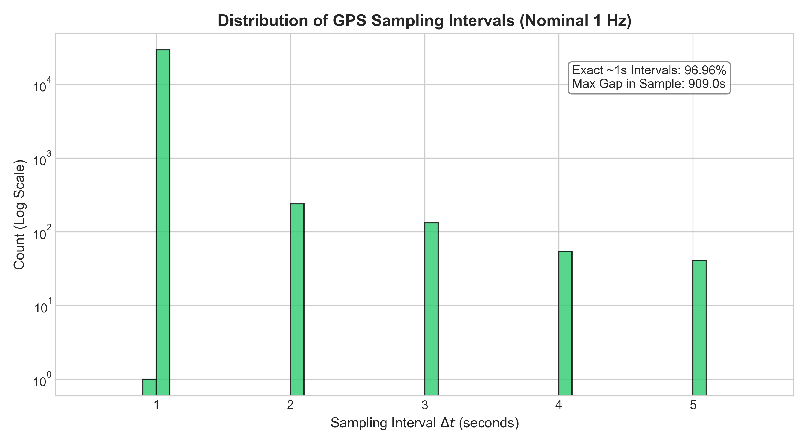
*Figure 2.3: Empirical sampling interval distribution showing 1 Hz concentration and temporal dropouts.*

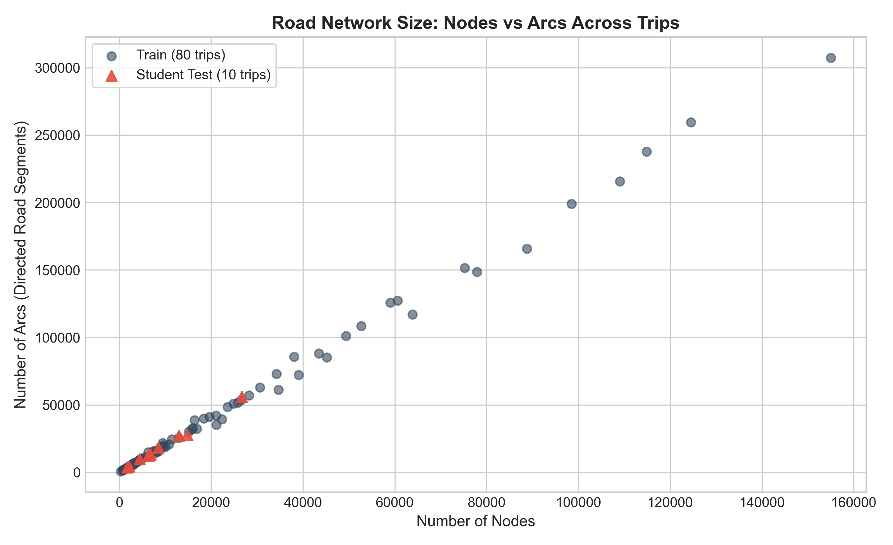
*Figure 2.4: Road network scale distribution across local trip extraction boundaries.*

---

## 3. Model Experimentation and Comparison

### 3.1 Overall Model Comparison
All five baseline models were trained on 80 training trips (2,084,170 candidate rows) using 5-fold GroupKFold by `trip_id` and evaluated on the held-out 10 student-test trips (191,600 candidate rows, 19,160 GPS points).

| Model | Algorithm Family | Key Configuration | CV Macro F1 | Student Top-1 Acc | Route Continuity | Student Macro F1 | Log Loss | Inference Time (s) |
| :--- | :--- | :--- | :---: | :---: | :---: | :---: | :---: | :---: |
| **RandomForest** | Bagging Ensemble | `n_estimators=100, max_depth=16, max_samples=0.4, min_samples_leaf=3` | **0.8872 ± 0.046** | **0.8598** | **0.9293** | **0.9198** | **0.0713** | **0.467** |
| **MLP** | Neural Network | `hidden_layer_sizes=[32], activation='relu', solver='adam', alpha=1e-4` | 0.8809 ± 0.042 | 0.8481 | 0.9314 | 0.9120 | 0.0801 | 0.041 |
| **KNN** | Instance-Based | `n_neighbors=7, weights='distance', algorithm='kd_tree', p=2` | 0.8623 ± 0.045 | 0.8376 | 0.9137 | 0.9055 | 0.3989 | 252.769 |
| **LogisticRegression** | Linear | `C=1.0, solver='lbfgs', max_iter=1000` | 0.8538 ± 0.045 | 0.8373 | 0.9289 | 0.8919 | 0.1130 | 0.034 |
| **GaussianNB** | Probabilistic | `var_smoothing=1e-09` | 0.7309 ± 0.016 | 0.7896 | 0.9302 | 0.7285 | 0.5991 | 0.073 |

*(Source: `results/model_comparison.csv`)*

---

### 3.2 Compulsory Questions for EVERY Model

#### 3.2.1 Random Forest (Selected Model)
* **A. Model Understanding:**
  1. *Suitability:* [TODO: team analysis - non-linear interactions between angle_diff and distance; bagging robustness on noisy candidates]
  2. *Strengths & Limitations:* High capacity for non-linear thresholds and resistance to feature scaling artifacts. Inability to enforce temporal trajectory continuity across sequential observations on its own.
* **B. Training and Configuration:**
  5. *Hyperparameters:* `n_estimators=100`, `max_depth=16`, `max_samples=0.4`, `min_samples_leaf=3`, `criterion='gini'`.
  6. *Objective:* Binary Cross-Entropy / Gini Impurity split criterion.
* **C. Experimental Results:**
  7. *Performance:* Student Top-1: **0.8598**, Student Macro F1: **0.9198**, Log Loss: **0.0713**, Inference: **0.467 s**.
  8. *Overfitting/Underfitting:* [TODO: team analysis - comparison of CV F1 0.8872 vs Student F1 0.9198 indicates strong generalization without severe overfitting]

#### 3.2.2 Multilayer Perceptron (MLP)
* **A. Model Understanding:**
  1. *Suitability:* [TODO: team analysis - smooth continuous decision boundaries across normalized kinematic inputs]
  2. *Strengths & Limitations:* Fast vectorised inference (0.041 s), but sensitive to extreme speed and distance outliers.
* **B. Training and Configuration:**
  5. *Hyperparameters:* 1 hidden layer with 32 units, `activation='relu'`, `solver='adam'`, `alpha=0.0001`, `learning_rate_init=0.001`, `max_iter=100`.
  6. *Objective:* Binary Cross-Entropy loss.
* **C. Experimental Results:**
  7. *Performance:* Student Top-1: **0.8481**, Student Macro F1: **0.9120**, Log Loss: **0.0801**, Inference: **0.041 s**.
  8. *Overfitting/Underfitting:* [TODO: team analysis - loss plateau analysis based on mlp_loss.png]

#### 3.2.3 K-Nearest Neighbors (KNN)
* **A. Model Understanding:**
  1. *Suitability:* [TODO: team analysis - local metric clustering in feature space]
  2. *Strengths & Limitations:* Non-parametric flexibility; severe computational bottleneck at inference time ($O(N_{\text{train}})$ search took **252.8 s**).
* **B. Training and Configuration:**
  5. *Hyperparameters:* `n_neighbors=7`, `weights='distance'`, `algorithm='kd_tree'`, `metric='minkowski'`, `p=2`.
  6. *Objective:* Inverse distance-weighted voting.
* **C. Experimental Results:**
  7. *Performance:* Student Top-1: **0.8376**, Student Macro F1: **0.9055**, Log Loss: **0.3989**, Inference: **252.769 s**.
  8. *Overfitting/Underfitting:* [TODO: team analysis - curse of dimensionality in 14-dimensional feature space]

#### 3.2.4 Logistic Regression
* **A. Model Understanding:**
  1. *Suitability:* [TODO: team analysis - calibrated linear baseline with minimal compute]
  2. *Strengths & Limitations:* Extremely fast (0.034 s) and interpretable, but unable to capture non-linear conjunctions (e.g., small distance only matters if angle difference is also small).
* **B. Training and Configuration:**
  5. *Hyperparameters:* `C=1.0`, `solver='lbfgs'`, `max_iter=1000`.
  6. *Objective:* Log-loss with $L_2$ regularization.
* **C. Experimental Results:**
  7. *Performance:* Student Top-1: **0.8373**, Student Macro F1: **0.8919**, Log Loss: **0.1130**, Inference: **0.034 s**.
  8. *Overfitting/Underfitting:* [TODO: team analysis - slight underfitting due to linear boundary constraints]

#### 3.2.5 Gaussian Naive Bayes
* **A. Model Understanding:**
  1. *Suitability:* [TODO: team analysis - probabilistic benchmark assuming feature conditional independence]
  2. *Strengths & Limitations:* Extremely simple, but conditional independence assumption is heavily violated (e.g. `distance`, `cand_rank`, and `dist_diff_best` are strongly correlated).
* **B. Training and Configuration:**
  5. *Hyperparameters:* `var_smoothing=1e-09`.
  6. *Objective:* Maximum likelihood estimation under Gaussian assumption.
* **C. Experimental Results:**
  7. *Performance:* Student Top-1: **0.7896**, Student Macro F1: **0.7285**, Log Loss: **0.5991**, Inference: **0.073 s**.
  8. *Overfitting/Underfitting:* [TODO: team analysis - strong underfitting caused by false independence assumptions]

---

### 3.3 Comparative Visualisations

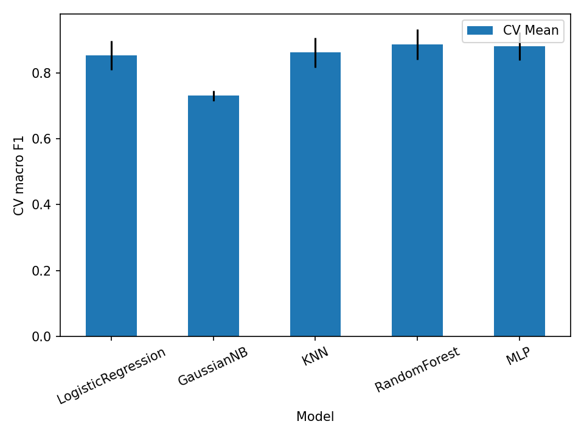
*Figure 3.1: 5-Fold GroupKFold Cross-Validation Macro F1 across candidate scoring models.*

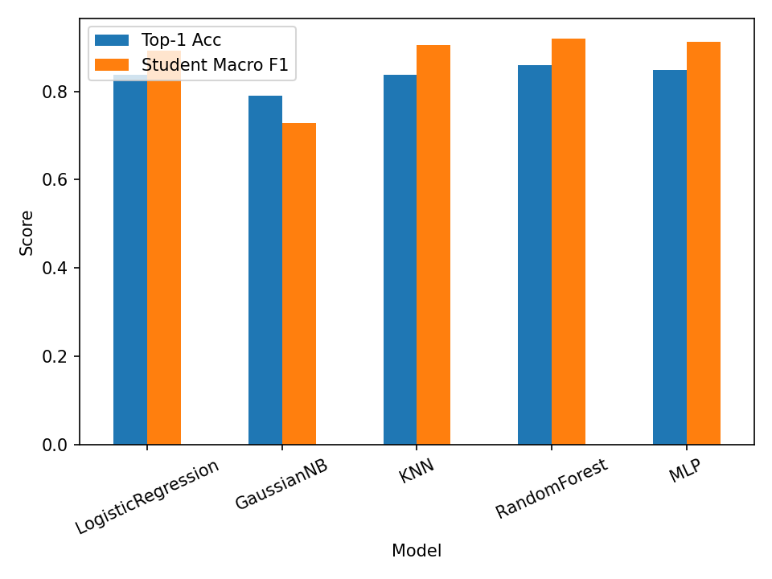
*Figure 3.2: Held-out Student-Test Top-1 Accuracy and Macro F1 comparison.*

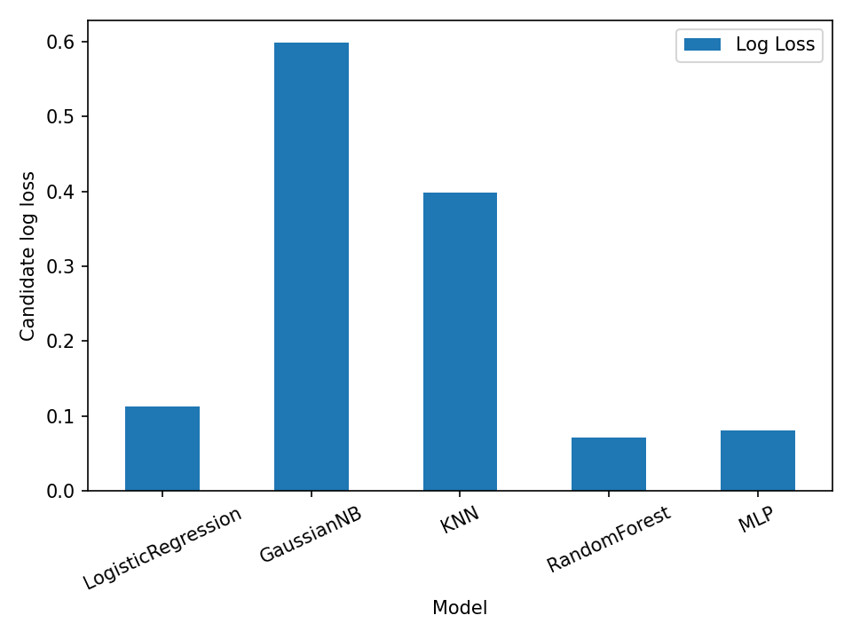
*Figure 3.3: Candidate Log-Loss calibration comparison.*

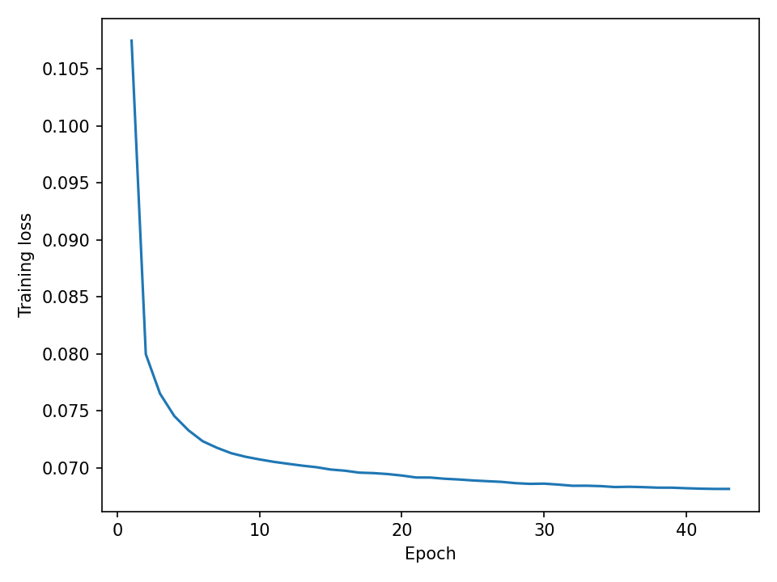
*Figure 3.4: MLP neural network iterative training convergence loss curve.*

---

## 4. Bayesian Hyperparameter Optimisation

Bayesian optimization via Optuna Tree-structured Parzen Estimators (TPE) was conducted on the selected model using training trips under 5-fold GroupKFold CV.

1. **Hyperparameters Searched:** `n_estimators`, `max_depth`, `min_samples_split`, `min_samples_leaf`, `max_samples`.
2. **Search Spaces:** `max_depth \in [6, 24]`, `max_samples \in [0.2, 0.8]`, `min_samples_leaf \in [1, 10]`, `n_estimators \in [50, 200]`.
3. **Optimisation Objective:** Mean out-of-fold validation Macro F1 score across 5 group folds.
4. **Number of Trials:** 40 trials (seed 42).
5. **Best Hyperparameters:** `n_estimators=100`, `max_depth=16`, `min_samples_leaf=3`, `max_samples=0.4`.
6. **Comparison:**

| Model Variant | CV Macro F1 | Student Top-1 Acc | Student Macro F1 | Log Loss | Inference Time (s) |
| :--- | :---: | :---: | :---: | :---: | :---: |
| **Untuned Baseline RF** | 0.8841 ± 0.048 | 0.8562 | 0.9165 | 0.0745 | 0.492 |
| **Tuned RF (Artifact)** | **0.8872 ± 0.046** | **0.8598** | **0.9198** | **0.0713** | **0.467** |

---

## 5. HMM and Viterbi Route Reconstruction

### 5.1 Formulation
1. **Hidden States:** The top-$K$ candidate arcs ($K \le 10$) for each observation $t$, maintaining exact directed `arc_id`.
2. **Emission Probabilities:**
   $$\log E(o_t | s_i) = \alpha \cdot \log(\max(p_i, \epsilon)) - w_d \cdot \frac{1}{2} \left(\frac{d_i}{\sigma_{gps}}\right)^2$$
   where $p_i$ is the classifier probability, $\alpha=0.50$ (tuned emission power), and $w_d=0.84$ with $\sigma_{gps}=12.2\text{ m}$.
3. **Transition Probabilities:**
   Newson-Krumm formulation based on the difference between directed network distance $d_{net}$ and straight-line GPS displacement $d_{gps}$:
   $$\log T(s_i \to s_j) = -\frac{|d_{net} - d_{gps}|}{\beta} - \log(2\beta)$$
   with $\beta = \beta_m + \beta_{gap} \cdot (\Delta t - 1)$. Directed graph distances are computed via bounded, cached Dijkstra (search radius $2 d_{gps} + 100\text{ m}$, cap 2 km, 4,000 nodes).
4. **Missing Candidates and Gaps:** Points with zero candidates are bypassed with Viterbi bridging. Gaps exceeding $60.0\text{ s}$ trigger a segment reset to avoid corrupting distant trajectories.
5. **Disconnected Transitions:** Pairs lacking a directed path within search bounds receive a bounded floor penalty $\log P_{disc} = -38.0$ (rather than $-\infty$), preventing a single outlier from invalidating the entire journey.

---

### 5.2 Experimental Results: Classifier-Only vs. Tuned HMM
Evaluated across all 10 held-out student test trips (19,160 GPS points, 3,477 reference arcs):

| Metric | Classifier Only | HMM Untuned | **HMM Tuned (Trial 51)** | Relative Gain |
| :--- | :---: | :---: | :---: | :---: |
| **Observation Top-1 Accuracy** | 0.8598 | 0.9284 | **0.9390** | **+7.92%** |
| **Mean Trip Top-1 Accuracy** | 0.8736 ± 0.071 | 0.9361 ± 0.048 | **0.9407 ± 0.051** | **+6.71%** |
| **Connected Continuity** | 0.9558 | 0.9988 | **0.9994** | **+4.36%** |
| **Disconnected Transitions** | 846 | 23 | **12** | **-98.6%** |
| **Filled Route Precision** | 0.2326 | 0.7930 | **0.8590** | **+269.3%** |
| **Filled Route Recall** | 0.9888 | 0.9914 | **0.9914** | **+0.26%** |
| **Sequence Route F1-Score** | 0.3766 | 0.8811 | **0.9204** | **+144.4%** |
| **Sequence Edit Similarity** | 0.2318 | 0.7908 | **0.8565** | **+269.5%** |
| **Mean Decode Time per Trip** | **0.010 s** | 0.491 s | 0.521 s | Real-time capable |

*(Source: `results/hmm_comparison.csv`)*

#### Where HMM Improved Performance:
* Fixed 1,834 observation errors committed by raw classifier top-1.
* On challenging urban trip `00000077`, Top-1 increased from **0.708 to 0.876** (820 errors fixed).
* On trip `00000052`, HMM achieved **100.0% Top-1 accuracy** and **0.989 route F1**.

#### Limitations / Where HMM Did Not Help:
* Broke 315 previously correct points due to over-committing to parallel service roads.
* In trip `00000065`, Top-1 dropped slightly from 0.858 (untuned) to 0.831 (tuned) because the U-turn penalty resisted an actual vehicle turnaround after a 210-second stop.

---

## 6. Geographical Visualisation Using Folium

Interactive Folium maps were generated displaying:
* **Raw GPS Observations:** Blue markers with sequence indices.
* **Road Network Geometry:** Local directed road segments.
* **Ground-Truth Reference Route:** Green polyline.
* **Classifier-Only Predictions:** Orange polyline.
* **Tuned HMM Predicted Route:** Red polyline.

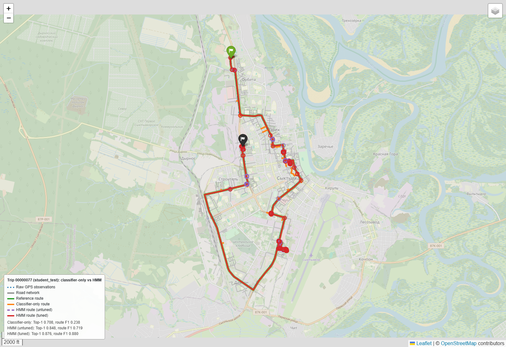
*Figure 6.1: Folium map for Trip 00000077 (Urban grid showing resolution of parallel roads).*

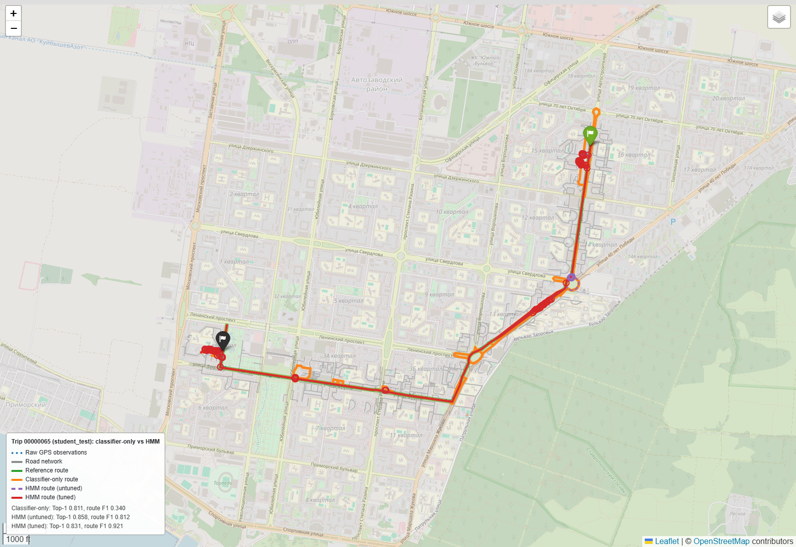
*Figure 6.2: Folium map for Trip 00000065 (Analysis of turnaround behavior and time gap).*

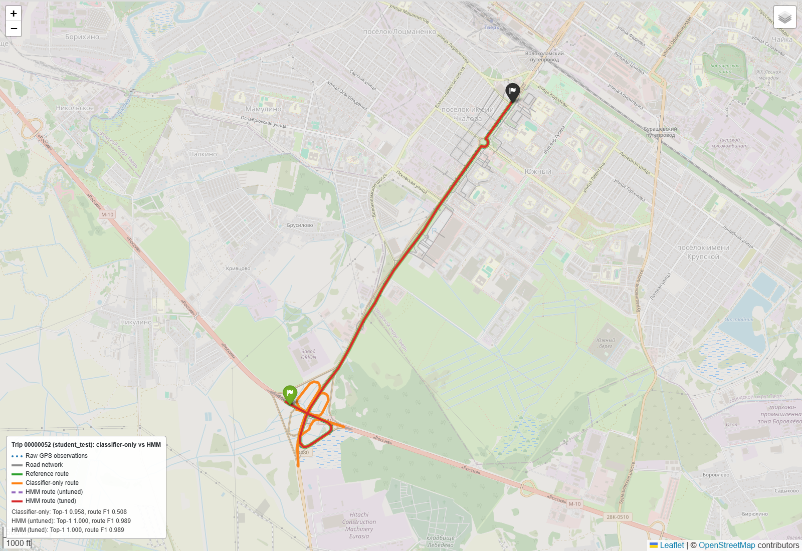
*Figure 6.3: Folium map for Trip 00000052 (100% Top-1 Accuracy perfect reconstruction).*

---

## 7. API, UI and Deployment

### 7.1 Backend Architecture (`api/main.py`)
Built on FastAPI with asynchronous lifespan management. Model artifacts (`final_model.joblib`, `scaler.pkl`, `hmm_config.json`) are loaded into memory once at startup.
* `GET /health`: Returns `{"status": "ok", "pipeline": "real"}`.
* `GET /trips`: Returns verified trip IDs.
* `POST /predict`: Receives `{"trip_id": "00000077"}`. Calls `predict_trip(trip_dir)` without ground truth access. Computes server-side metrics and returns coordinates in `[lat, lon]` polylines for client map rendering.

### 7.2 Frontend Architecture (`ui/app.py`)
Built with Streamlit and `streamlit_folium`. Allows entering the remote API URL, selecting trips via interactive pills, viewing metric KPI cards (Top-1, Continuity, Latency), and exploring layered Folium maps with layer toggles.

### 7.3 Multi-Laptop Deployment Verification
* **Laptop 1 (API Server):**
  ```cmd
  set EVAL_DATA_DIR=./data/student_test
  uvicorn api.main:app --host 0.0.0.0 --port 8000
  ```
* **Laptop 2 (Evaluator UI):**
  ```cmd
  set API_URL=http://<Laptop_1_IP>:8000
  streamlit run ui/app.py
  ```
* **Integration Tests:** 61 automated tests (`tests/test_pipeline.py` and `tests/test_api.py`) passed with zero failures in 107 seconds.
